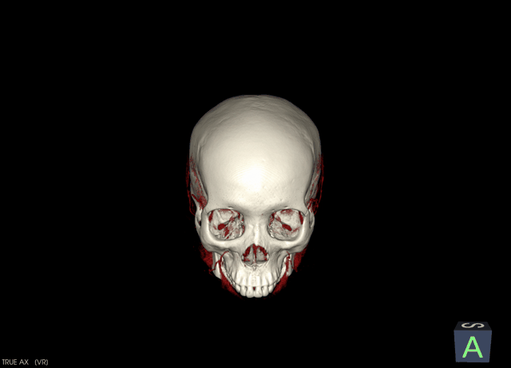
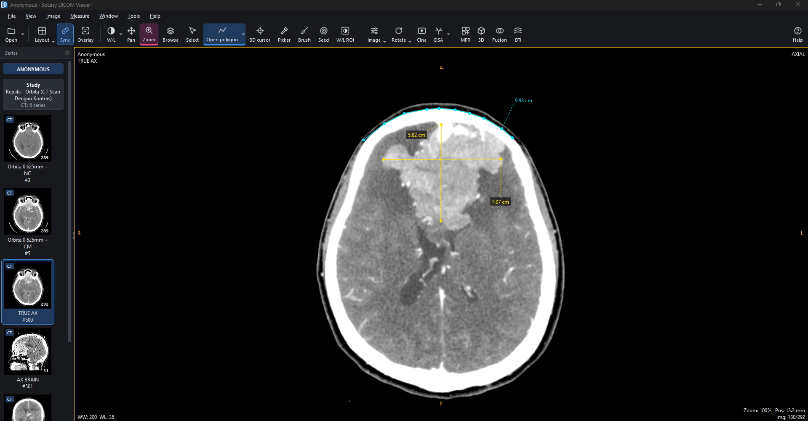
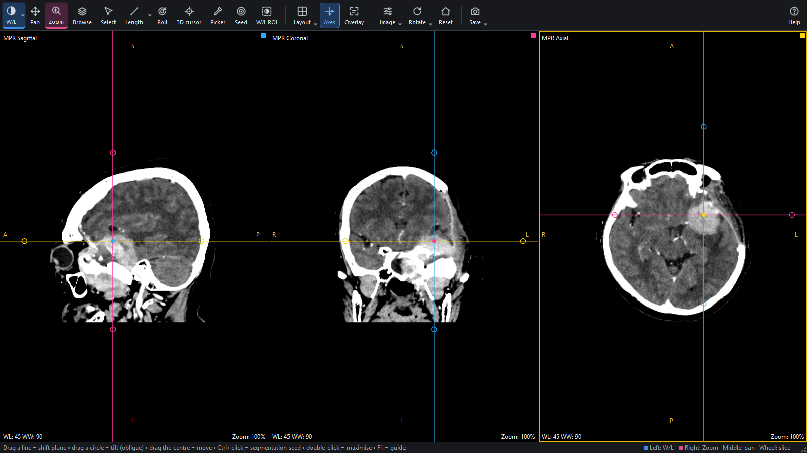
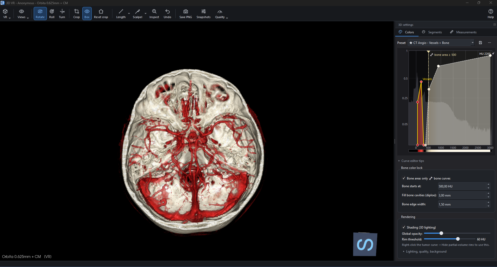
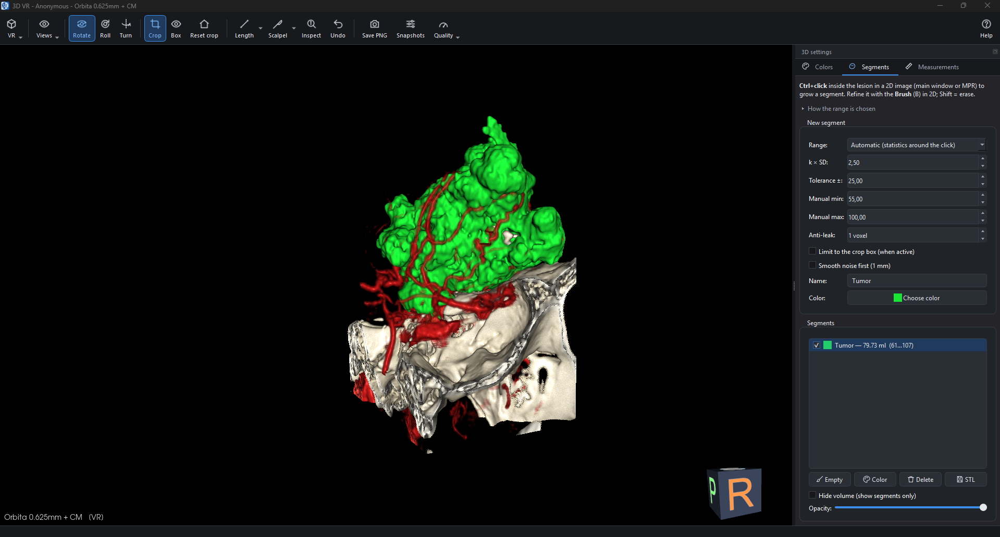
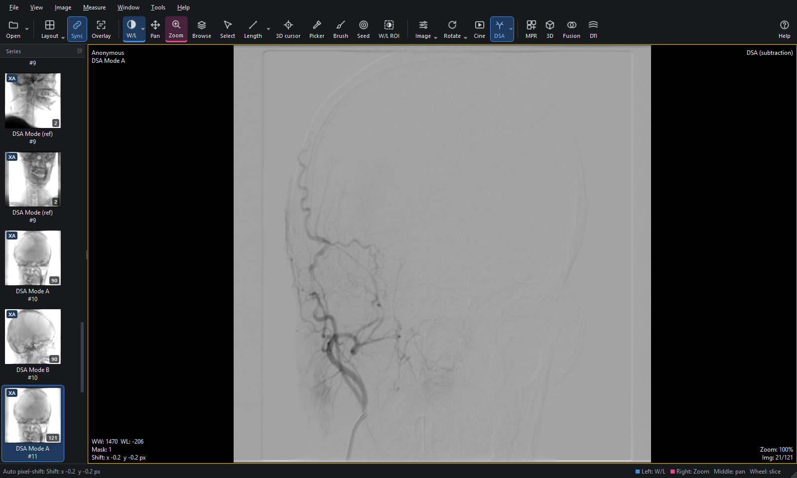
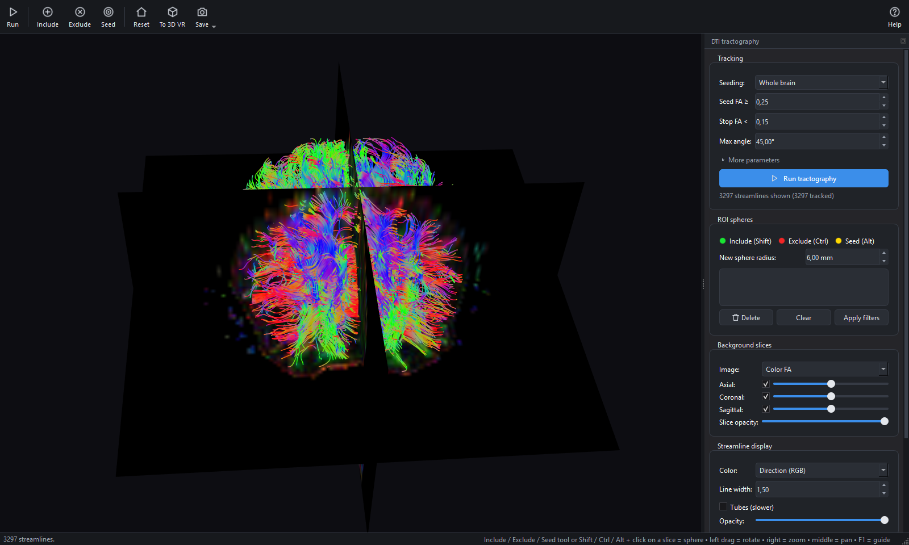
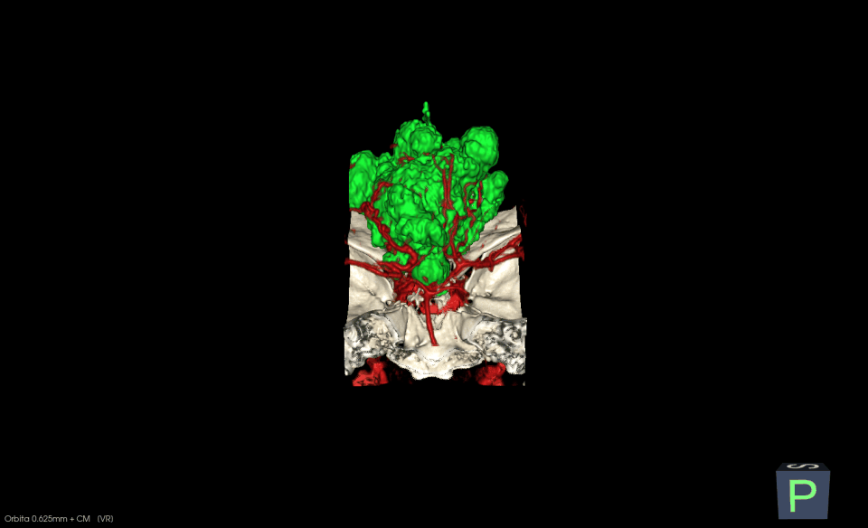
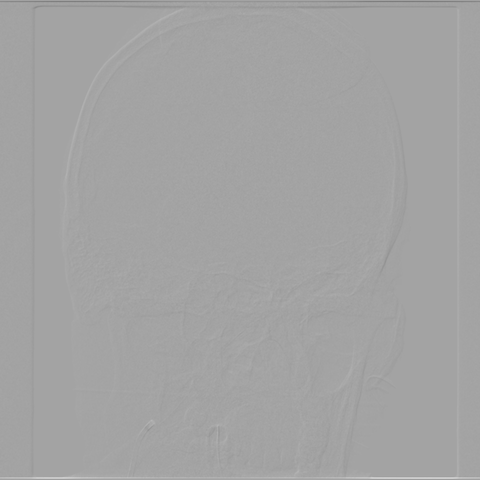

<p align="center">
  
</p>

<h1 align="center">SoEasy DICOM Viewer</h1>

<p align="center">
  A fast, free DICOM viewer for Windows — 2D, MPR, colour 3D volume rendering, tumour segmentation,<br>
  digital subtraction angiography (DSA) and DTI tractography in one compact application.
</p>

<p align="center">
  <a href="LICENSE"></a>
  
  
</p>

<p align="center">
  <a href="https://github.com/TrithoneSE/SoEasy-DICOM-Viewer/releases/latest"></a>
  &nbsp;
  <a href="https://trithonese.github.io/SoEasy-DICOM-Web/"></a>
</p>

<p align="center">
  
</p>

> **On an iPad, iPhone or a computer without Windows?** Use **[SoEasy DICOM Web](https://trithonese.github.io/SoEasy-DICOM-Web/)**,
> the browser version of this viewer — 2D, cine, DSA, MPR, reference lines and colour 3D, nothing to install, images
> never uploaded. See [Web version](#web-version) for what each version can do.

> **Not a medical device.** SoEasy DICOM Viewer is a visualisation tool for education, research and personal use.
> It is not certified for diagnosis or treatment decisions. Always rely on the original images and the radiologist's
> report.

---

## Contents

- [Highlights](#highlights)
- [Screenshots](#screenshots)
- [Download and install](#download-and-install)
- [Web version](#web-version)
- [System requirements](#system-requirements)
- [Getting started](#getting-started)
- [Features in detail](#features-in-detail)
- [Mouse and keyboard](#mouse-and-keyboard)
- [Privacy](#privacy)
- [Building from source](#building-from-source)
- [Project layout](#project-layout)
- [Contributing](#contributing)
- [Licence and third-party software](#licence-and-third-party-software)

## Highlights

- **Opens anything DICOM** — folders, CD / DVD / USB, DICOMDIR, single files and archives (.zip, .rar, .7z, .tar),
  including JPEG, JPEG-lossless, JPEG 2000 and RLE compressed images. Several patients side by side in separate
  windows.
- **Quick to start, light on memory** — studies open while they are still being read; compressed angiography runs
  show their first frame at once and decode the rest in the background. A large CT with MPR and 3D open uses
  about 1 GB of RAM.
- **2D viewing** with free window / level, presets, measurements (length, angle, Cobb, ellipse, rectangle, polygon,
  text…), MIP / MinIP slabs, filters, colour maps and a layout of up to 5 × 5 viewports.
- **Reference lines** between viewports — an axial, a sagittal and a coronal series side by side show where each
  other's slices cut them, follow every scroll and can be dragged like MPR axes; handy for MRI sequences that cover
  only part of the head.
- **MPR** — sagittal, coronal and axial planes, obliquely rotatable, with every 2D tool.
- **Colour 3D volume rendering** with an interactive curve editor: tissue colours and opacity drawn as curves over
  the histogram, a **bone colour lock** that keeps bone in bone colours, and a **rim filter** that separates an
  enhancing tumour from the walls of contrast-filled vessels.
- **Segmentation** — click a lesion, get a 3D surface and its volume in ml; refine with a brush; export STL.
- **3D tools** — crop box, scalpel, 3D measurements, snapshots and fly-through movies (animated GIF).
- **DSA** for X-ray angiography runs: mask from the scanner or any frame, manual and automatic pixel shift, cine at
  the run's own frame rate.
- **DTI** — tensor fit, FA / MD / colour-FA maps and whole-brain or ROI-based tractography.
- **Fusion** — overlay one series on another (e.g. FLAIR or FA on T1) in true patient coordinates.
- **Runs without a graphics card** — falls back to software OpenGL automatically.
- **Anonymous display** — one shortcut hides names and dates on screen for screenshots and teaching.

## Screenshots

All images below come from real clinical studies shown in the viewer's anonymous display mode.

| | |
|---|---|
|  |  |
| **2D viewer** — contrast CT, axial with a length measurement (open polygon and length feature with moveable caption) | **MPR** — sagittal, coronal and axial planes centred on a skull-base tumour. |
|  |  |
| **3D volume rendering** — skull base seen from above with the vault cropped away; the curve editor on the right. | **Segmentation** — a tumour grown from one click (79.73 ml) shown with the surrounding vessels. |
|  |  |
| **DSA** — subtracted carotid run with automatic pixel shift. | **DTI tractography** — whole-brain streamlines over colour FA (MRI, 20 directions). |

| | |
|---|---|
|  |  |
| **Segmentation in motion** — the segmented tumour turning with its feeding arteries. | **DSA cine** — a subtracted run playing at the scanner's frame rate. |

## Download and install

Download the latest version from the [**Releases**](../../releases) page:

| File | What it is |
|---|---|
| `SoEasy-DICOM-Viewer-x.y.z-Setup.exe` | Installer (recommended): Start-menu and desktop shortcuts, *Open in SoEasy DICOM Viewer* on folders in Explorer, optional *Open with* for .dcm files, clean uninstall. |
| `SoEasy-DICOM-Viewer-x.y.z-portable.zip` | No installation: unzip anywhere (e.g. a USB stick) and run `SoEasy DICOM Viewer.exe`. |
| `SHA256SUMS.txt` | Checksums to verify the downloads. |

The installer is not code-signed yet, so Windows SmartScreen may show *Windows protected your PC*: choose
*More info → Run anyway*. Colour presets and settings are kept in `%APPDATA%\DicomColorViewer` and survive updates
and uninstalling.

## Web version

**[SoEasy DICOM Web](https://trithonese.github.io/SoEasy-DICOM-Web/)** is the browser version of this viewer for
iPad, iPhone, Android, Mac and Linux — and for any Windows PC where you cannot install software. Open the link; on
iPad / iPhone choose *Share → Add to Home Screen* to use it full-screen and offline. All processing stays on the
device; images are never uploaded. Its repository is
[TrithoneSE/SoEasy-DICOM-Web](https://github.com/TrithoneSE/SoEasy-DICOM-Web).

Colour presets are the same .json files in both: export a preset here and import it in the web version, or the
other way round.

| | Desktop (this app) | [Web](https://trithonese.github.io/SoEasy-DICOM-Web/) |
|---|:---:|:---:|
| Runs on | Windows 10 / 11 | any modern browser, iPad, iPhone |
| 2D, presets, MIP / MinIP slabs, cine | ✅ | ✅ |
| DSA with automatic pixel shift | ✅ | ✅ |
| Layouts with reference lines | up to 5 × 5 | up to 2 × 2 |
| MPR, colour 3D, bone lock, rim filter, crop, scalpel, snapshots | ✅ | ✅ |
| Measurements | all 2D and 3D tools | length |
| Segmentation, STL, 3D movies | ✅ | — |
| DTI, fusion, anonymous display | ✅ | — |
| Archives | .zip, .rar, .7z, .tar | .zip |

The full comparison is in the [SoEasy DICOM Web README](https://github.com/TrithoneSE/SoEasy-DICOM-Web#web-or-desktop).

## System requirements

| | Minimum | Recommended |
|---|---|---|
| Windows | 10 or 11, 64-bit | 11, 64-bit |
| Memory | 4 GB | 8 GB or more for large CT studies in 3D |
| Graphics | none (software rendering) | any GPU with OpenGL 3.2+ (Intel HD, AMD, NVIDIA) |
| Disk | 300 MB | |

On a PC without a working graphics driver — a virtual machine, a remote session, a very old office PC — the
viewer switches to software OpenGL by itself: every feature works, 3D is rendered by the processor and is
slower (the 3D view then uses half resolution for large volumes). The Start-menu shortcut
*SoEasy DICOM Viewer (safe graphics)* forces this mode if a graphics driver misbehaves.

## Getting started

1. **Open a study**: *Open* (Ctrl+O) and pick a folder, or drag a folder, files or an archive onto the window. In
   Explorer you can also right-click a folder → *Open in SoEasy DICOM Viewer*.
2. **Browse**: the series list on the left groups thumbnails by patient and study. Click a thumbnail, or drag it onto
   any viewport. Scroll with the mouse wheel; drag with the left button to change the window / level.
3. **Measure**: choose a tool (*Length* L, *Ellipse* E, …) — the left mouse button now draws it. Right-click a tool
   button to put it on the right mouse button instead.
4. **MPR / 3D**: *MPR* (Ctrl+M) and *3D* (Ctrl+3) open their own windows for the series in the active viewport.
5. Press **F1** in any window for its quick guide.

## Features in detail

### Loading
- Recursive folder scan, DICOMDIR, and archives (zip via Python, rar / 7z / tar via Windows' built-in `tar.exe`,
  with 7-Zip or WinRAR as fallback), nested up to three levels.
- Series are assembled in patient space from DICOM position and orientation, so axial, sagittal and oblique series
  line up; console reformats that include a reference image of another plane keep all their parallel slices.
- Multi-frame files (X-ray angiography runs, ultrasound loops) are one entry each — both planes of a biplane run —
  and play on opening. Compressed frames are decoded in the background, the frame on screen first.
- Files are read several at a time: the first opening of a folder (cold disk cache, antivirus scanning) is several
  times faster than reading them one by one.
- A second study opens in a new window (always for another patient) or, on request, in the same window for fusion.

### 2D viewing
- Window / level by dragging, with presets (keys 1–9), exact values, *Auto* (0) and *W/L ROI* (draw a box).
- Layouts from 1 × 1 to 5 × 5, slice synchronisation between series, cross-reference cursor (Q), rotate / flip /
  invert, MIP / MinIP / average slabs, smoothing and sharpening filters, colour maps.
- Reference lines (Ctrl+Shift+L): every viewport shows the current slices of the other viewports as coloured lines
  (yellow axial, pink coronal, blue sagittal) labelled with the series name. A line is only as long as that slice has
  image, so a partial MRI slab shows where it starts and ends. Scrolling any viewport moves its line in the others;
  dragging a line moves that viewport's slice. Lines are drawn only between series in the same patient coordinate
  system (frame of reference).
- Measurements: length, angle, Cobb angle, open / closed polygon, ellipse and rectangle ROIs (area, mean, SD,
  min / max), arrow, pencil, text and deviation. Lengths are shown in mm below 1 cm and in cm above. Captions can be
  dragged out of the way. ABC/2 volume calculator.

### MPR
- Three orthogonal planes with draggable axes; drag a circle handle to tilt a plane (oblique MPR), drag the centre to
  move; *Roll* turns one view in its own plane. All 2D tools work in every view.

### 3D volume rendering
- GPU ray casting with lighting; VR, MIP and MinIP; quality settings and half-resolution mode for low memory.
- **Curve editor**: each tissue is a curve (opacity over HU) with its own colours, drawn over the histogram. Built-in
  presets (bone, CT angiography with arteries / veins, skin, muscle, enhancing lesion, lung), your own presets, and a
  colour picker that creates a curve from a tissue you click in 2D.
- **Bone colour lock**: the bone area is coloured only by bone curves, so vessels or a tumour with the same HU as the
  edge of bone keep their own colour.
- **Rim filter**: curves marked *hide partial-volume rims* colour only homogeneous tissue, using a value × gradient
  transfer function, so an enhancing tumour is not confused with the walls of contrast-filled vessels. The *Rim
  threshold* slider sets how strict it is.
- Crop box, scalpel (cut inside / outside a drawn area, undo), inspect (click = HU and colour), orientation cube,
  standard views, free rotate / roll / turn.
- 3D measurements: length, angle, Cobb, open polygon, arrow and text placed on the rendered surface.
- **Snapshots and movies**: save views (camera, crop, colours), jump between them, and render a smooth fly-through as
  an animated GIF or PNG sequence.

### Segmentation
- Ctrl+click a lesion in 2D (or use *Seed*): the region grows from the click with a range from the local statistics
  (or a tolerance, a manual range, or the range of a colour curve), limited to the crop box if wanted, with an
  anti-leak setting.
- *Smooth noise first* (off by default) grows on a lightly smoothed copy so CT noise does not break a lesion apart;
  leave it off for thin structures such as small vessels. Toggling it re-grows the selected segment from its click
  straight away, so you can compare both results (not after brush edits, which re-growing would discard).
- Result: a smooth 3D surface with its volume in ml; brush (B) to add or erase in 2D; STL export.

### DSA (digital subtraction angiography)
- `/` turns subtraction on: each frame minus the mask, on a light grey background. The mask is taken from the
  scanner's Mask Subtraction Sequence when present, otherwise frame 2; logarithmic subtraction for linear data.
- `Shift+/` makes the displayed frame the mask, `Ctrl+Shift+/` resets it.
- **Pixel shift** to correct patient motion: drag the mask (Shift+M), move it with Shift+arrows (1 px) or
  Ctrl+Shift+arrows (0.1 px), or let *Auto shift* (Ctrl+M in DSA mode) align it inside the yellow square you click.
- **Cine bar** over the image: previous / next series, previous / next frame, play / pause (Space) and the frame
  rate; runs play at the frame rate stored in the file.

### DTI and fusion
- Diffusion series with standard, Siemens (including mosaic), GE or Philips diffusion tags; tensor fit; FA, MD,
  colour-FA and b0 maps added to the series list.
- Deterministic tractography (whole brain or seed spheres), include / exclude spheres, colour by direction or FA,
  tubes, export, and sending the tracts into a 3D volume rendering.
- Fusion overlays any series on the active viewport with a colour map and opacity, matched in patient coordinates.

## Mouse and keyboard

| Main window | |
|---|---|
| Left / right mouse button | the tool assigned to it (click / right-click a tool button) |
| Middle button, wheel, Ctrl+wheel | pan, next slice, zoom at the cursor |
| W, M, Z, S | window / level, pan, zoom, browse |
| L, E, U, G, O, A, C, D, Y, P, T | length, ellipse, rectangle, polygon, open polygon, angle, Cobb, deviation, arrow, pencil, text |
| Q, K, B, J, R | 3D cursor, colour picker, brush, segmentation seed, W/L ROI |
| 1–9, 0, I | window presets, auto window, invert |
| Ctrl+O, Ctrl+Shift+O, Ctrl+N | open folder, open files / archive, new window |
| Ctrl+M, Ctrl+3, Ctrl+U, Ctrl+D | MPR, 3D, fusion, DTI |
| Ctrl+Space or Space | cine play / pause |
| / , Shift+/ , Ctrl+Shift+/ , Shift+M | DSA on / off, displayed frame as mask, reset mask, manual pixel shift |
| Ctrl+L, Ctrl+Shift+L, X, F, F11 | synchronise slices, reference lines, crosshair, maximise viewport, full screen |
| Ctrl+Shift+H | hide patient identity on screen |
| Ctrl+S, Ctrl+Shift+C, Ctrl+T | save image, copy image, DICOM tags |
| F1 | quick guide (every window has its own) |

## Privacy

- Everything runs on your computer. The viewer makes no network connections and sends no data or statistics
  anywhere.
- Archives are unpacked into a temporary folder that is deleted when the viewer closes.
- *View → Hide patient identity* (Ctrl+Shift+H) replaces names, birth dates and study dates with "Anonymous" in the
  image overlay, window titles, series list and tooltips. The DICOM files themselves are never modified.
  Information burned into the pixels (e.g. dose reports or screen captures) cannot be hidden this way.

## Building from source

Requirements: Windows 10 / 11 64-bit, [Python 3.12](https://www.python.org/downloads/) 64-bit, and for the installer
[NSIS 3](https://nsis.sourceforge.io) (`winget install NSIS.NSIS`).

```powershell
git clone https://github.com/TrithoneSE/SoEasy-DICOM-Viewer.git
cd SoEasy-DICOM-Viewer
py -3.12 -m venv .venv
.venv\Scripts\python -m pip install -r requirements-lock.txt
.venv\Scripts\python main.py                      # run from source
.venv\Scripts\python tests\run_all.py             # GUI tests on the synthetic samples
.venv\Scripts\python packaging\build.py --installer
```

`packaging/build.py` builds `dist\SoEasy DICOM Viewer\` with PyInstaller, then runs the built program's own
`--selftest` on the graphics driver and on software OpenGL (2D, MPR, 3D rendering, DSA, DTI, archive extraction,
every image codec) and refuses a build that fails. With `--installer` it also writes the NSIS installer, a portable
zip and their SHA-256 checksums. Pushing a tag such as `v1.0.0` builds the same files on GitHub Actions and attaches
them to a draft release.

Keep the project in a short path (e.g. `C:\src\SoEasy-DICOM-Viewer`): Qt's deep folder names can exceed the Windows
path limit otherwise.

## Project layout

```
main.py                 entry point: graphics selection, logging, --selftest
dcv/
  loader.py             folder / archive scan, series assembly, background frame decoding
  archive.py            .zip / .rar / .7z / .tar extraction
  main_window.py        main window, series list, layouts, menus
  slice_view.py         2D viewport: tools, measurements, DSA, cine
  measure.py            2D measurements
  mpr_window.py         MPR window
  vr_window.py          3D window: curve editor, segmentation, snapshots
  volume_view.py        3D rendering, crop, scalpel, 3D measurements
  tf_model.py           colour curves and presets
  tf_editor.py          curve editor widget
  segment.py            per-series state, bone lock, region growing
  dsa.py                digital subtraction
  dti.py                diffusion tensor and tractography
  tract_window.py       tractography window
  snapshots.py          3D snapshots and movies
  graphics.py           hardware / software OpenGL selection
  vtk_lite.py           the VTK classes in use (keeps the build small)
  privacy.py            anonymous display
  selftest.py           build self-test
samples/                synthetic studies (head CT, phantom, MRI with DTI) used by the tests
tests/                  GUI tests driving the real windows
packaging/              PyInstaller spec, NSIS installer, build script
```

## Contributing

Bug reports and pull requests are welcome. Please do **not** attach patient images or DICOM files to issues — describe
the scanner, the series type and what you saw, or share an anonymised study privately. Run `tests\run_all.py`
before sending a pull request; a new feature or fix comes with a test.

## Licence and third-party software

SoEasy DICOM Viewer is free software under the **GNU General Public License v3.0** (see [LICENSE](LICENSE)).
You may use, study, share and modify it; distributed modified versions must stay under the same licence.

The application is built on these open-source projects, each under its own licence:

| Project | Use | Licence |
|---|---|---|
| [Qt for Python (PySide6)](https://www.qt.io/qt-for-python) | user interface | LGPL-3.0 |
| [VTK](https://vtk.org) | 3D rendering | BSD-3-Clause |
| [pydicom](https://pydicom.github.io) | DICOM reading | MIT |
| [pylibjpeg](https://github.com/pydicom/pylibjpeg), pylibjpeg-libjpeg, pylibjpeg-openjpeg | JPEG / JPEG 2000 decoding | MIT, GPL-3.0, MIT |
| [NumPy](https://numpy.org) | image maths | BSD-3-Clause |
| [Pillow](https://python-pillow.org) | GIF / PNG output | MIT-CMU |
| [Mesa](https://mesa3d.org) (shipped with Qt as `opengl32sw.dll`) | software OpenGL | MIT |
