<p align="center">
  
</p>

<h1 align="center">SoEasy DICOM Viewer</h1>

<p align="center">
  A fast, free DICOM viewer for Windows — 2D, MPR, colour 3D volume rendering, tumour segmentation,<br>
  digital subtraction angiography (DSA) and DTI tractography in one compact application.
</p>

<p align="center">
  <a href="LICENSE"></a>
  
  
</p>

<p align="center">
  <a href="https://github.com/TrithoneSE/SoEasy-DICOM-Viewer/releases/latest"></a>
  &nbsp;
  <a href="https://trithonese.github.io/SoEasy-DICOM-Web/"></a>
</p>

<p align="center">
  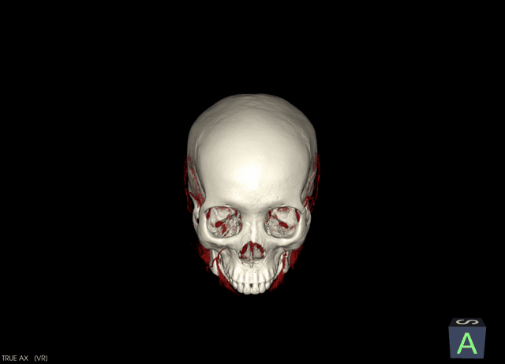
</p>

> **On an iPad, iPhone or a computer without Windows?** Use **[SoEasy DICOM Web](https://trithonese.github.io/SoEasy-DICOM-Web/)**,
> the browser version of this viewer — 2D, cine, DSA, MPR, reference lines and colour 3D, nothing to install, images
> never uploaded. See [Web version](#web-version) for what each version can do.

> **Not a medical device.** SoEasy DICOM Viewer is a visualisation tool for education, research and personal use.
> It is not certified for diagnosis or treatment decisions. Always rely on the original images and the radiologist's
> report.

---

## Contents

- [Highlights](#highlights)
- [Screenshots](#screenshots)
- [What's new in 1.0.5](#whats-new-in-105)
- [Download and install](#download-and-install)
- [Web version](#web-version)
- [System requirements](#system-requirements)
- [Getting started](#getting-started)
- [Features in detail](#features-in-detail)
- [Mouse and keyboard](#mouse-and-keyboard)
- [Privacy](#privacy)
- [Building from source](#building-from-source)
- [Project layout](#project-layout)
- [Contributing](#contributing)
- [Licence and third-party software](#licence-and-third-party-software)

## Highlights

- **Opens anything DICOM** — folders, CD / DVD / USB, DICOMDIR, single files and archives (.zip, .rar, .7z, .tar),
  including JPEG, JPEG-lossless, JPEG 2000 and RLE compressed images. Several patients side by side in separate
  windows.
- **Quick to start, light on memory** — studies open while they are still being read; compressed angiography runs
  show their first frame at once and decode the rest in the background. A large CT with MPR and 3D open uses
  about 1 GB of RAM.
- **2D viewing** with free window / level, presets, measurements (length, angle, Cobb, ellipse, rectangle, polygon,
  text…), MIP / MinIP slabs, filters, colour maps and a layout of up to 5 × 5 viewports.
- **Collage** — a series as one 5 × 5, 4 × 4 or 4 × 3 image in one click, one slice every 5 mm (or any interval),
  centred in the series and movable with a slider; thick-slice series keep all their slices.
- **Reference lines** between viewports — an axial, a sagittal and a coronal series side by side show where each
  other's slices cut them, follow every scroll and can be dragged like MPR axes; handy for MRI sequences that cover
  only part of the head.
- **MPR** — sagittal, coronal and axial planes, obliquely rotatable, with every 2D tool.
- **Colour 3D volume rendering** with an interactive curve editor: tissue colours and opacity drawn as curves over
  the histogram, a **bone colour lock** that keeps bone in bone colours, and a **rim filter** that separates an
  enhancing tumour from the walls of contrast-filled vessels.
- **Bone that stays bone** — the bone lock takes bone from the study's plain (pre-contrast) scan when there is one,
  lined up slab by slab if the patient moved: what was bone before contrast is bone, and only what got brighter is a
  vessel, so an aneurysm on the clinoid stays whole and a child's thin facial bones stay white. A newborn's skull plates
  are found by their shape, with the fontanelles and sutures left open. 3D opens with the lock on in one step.
- **Arteries and veins** in two colours — from both phases of a CTA, or from one routine contrast series with a vessel
  atlas of the head and two trees grown through the vessels (88 % of vessel voxels right on 6 real CTAs).
- **CT venography** — the dural sinuses, cortical and deep veins in blue over a faint brain and skull, arteries hidden.
- **Segmentation** — click a lesion, get a 3D surface and its volume in ml; tune what enters it with two handles
  over its histogram, refine with a brush; export STL.
- **3D tools** — crop box, scalpel, 3D measurements, snapshots and fly-through movies (animated GIF).
- **DSA** for X-ray angiography runs: mask from the scanner or any frame, manual and automatic pixel shift, cine at
  the run's own frame rate.
- **DTI** — tensor fit, FA / MD / colour-FA maps and whole-brain or ROI-based tractography.
- **Fusion** — overlay one series on another (e.g. FLAIR or FA on T1) in true patient coordinates.
- **Runs without a graphics card** — falls back to software OpenGL automatically.
- **Anonymous display** — one shortcut hides names and dates on screen for screenshots and teaching.

## Screenshots

All images below come from real clinical studies shown in the viewer's anonymous display mode.

| | |
|---|---|
| 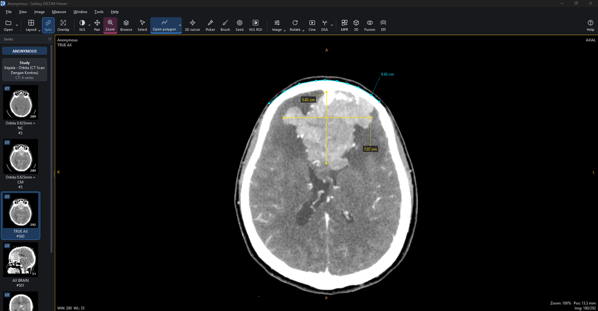 | 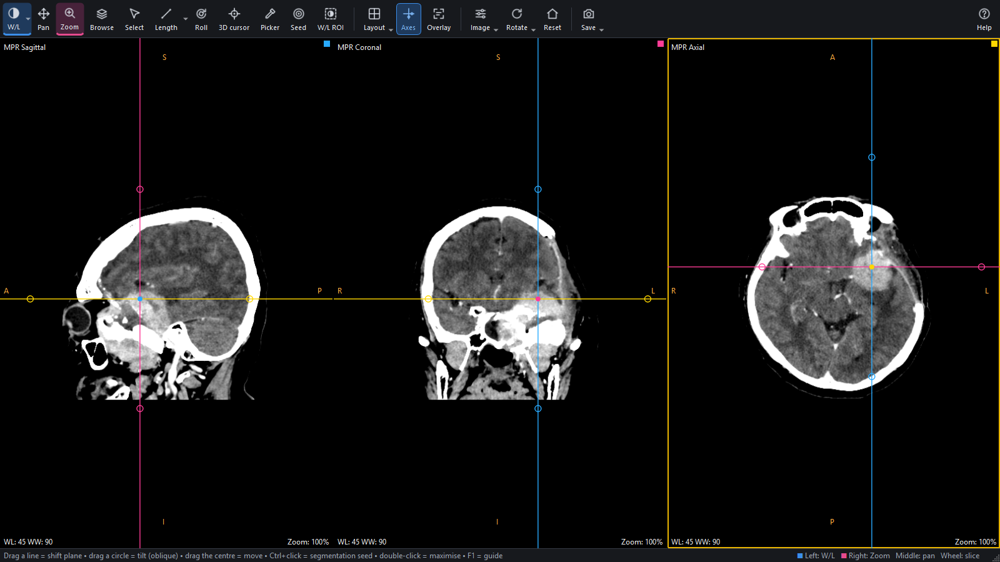 |
| **2D viewer** — contrast CT, axial with a length measurement (open polygon and length feature with moveable caption) | **MPR** — sagittal, coronal and axial planes centred on a skull-base tumour. |
| 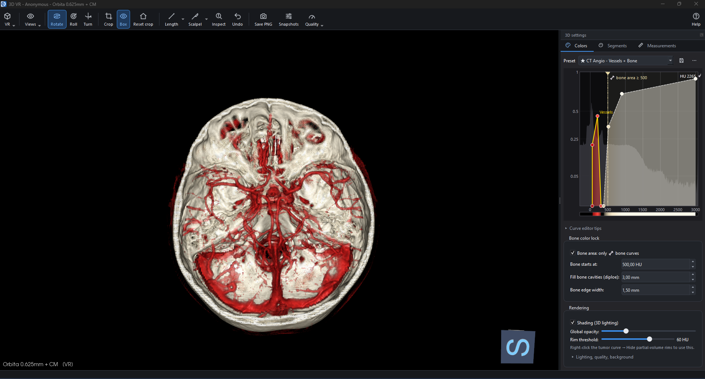 | 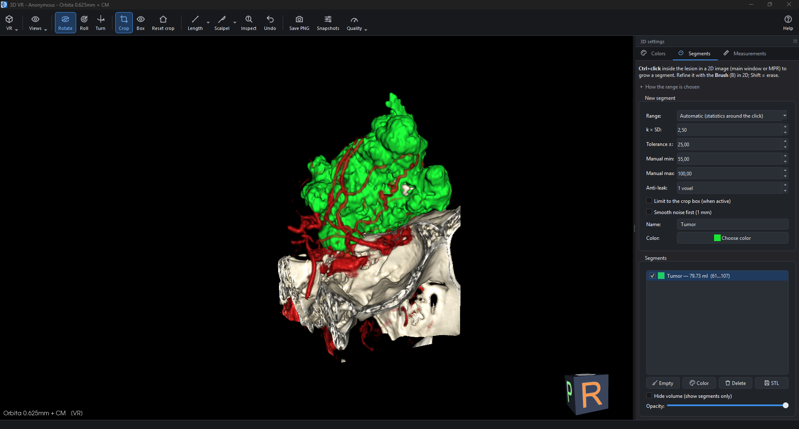 |
| **3D volume rendering** — skull base seen from above with the vault cropped away; the curve editor on the right. | **Segmentation** — a tumour grown from one click (79.73 ml) shown with the surrounding vessels. |
| 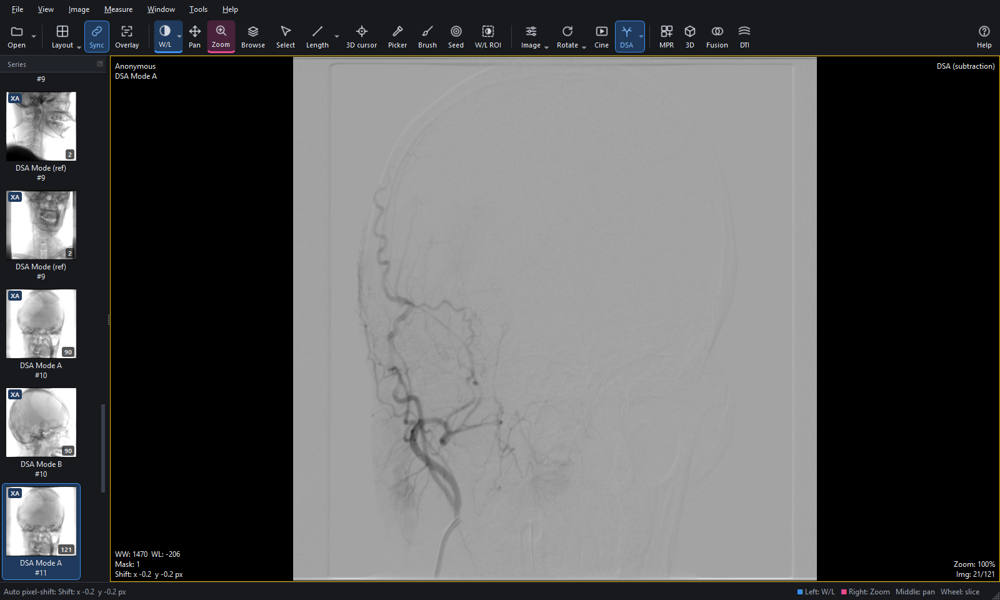 | 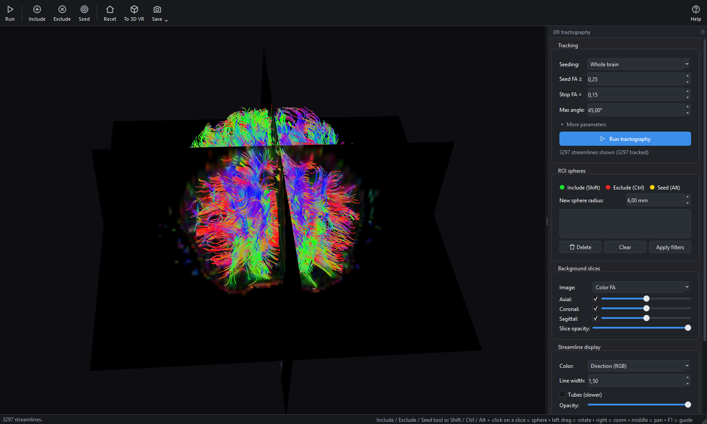 |
| **DSA** — subtracted carotid run with automatic pixel shift. | **DTI tractography** — whole-brain streamlines over colour FA (MRI, 20 directions). |

| | |
|---|---|
| 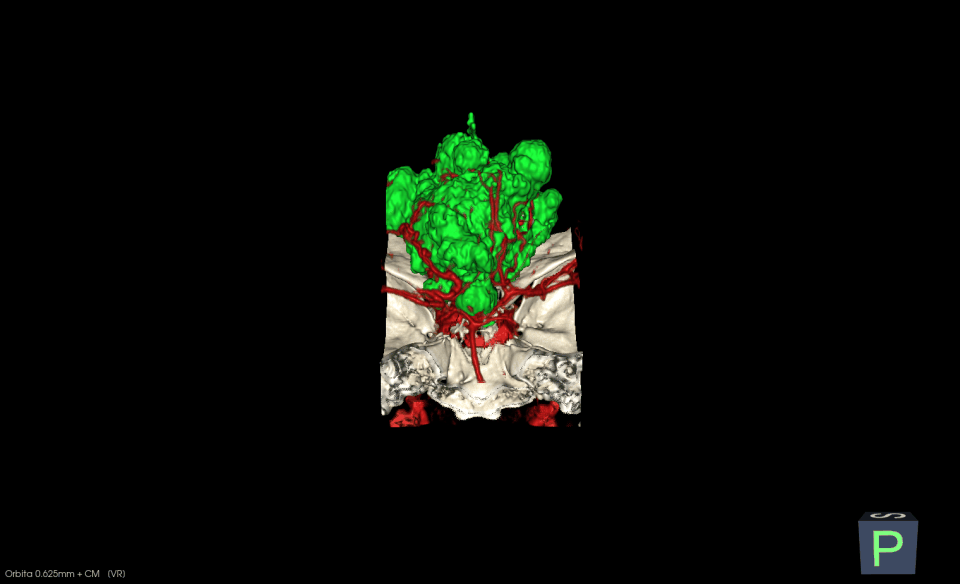 | 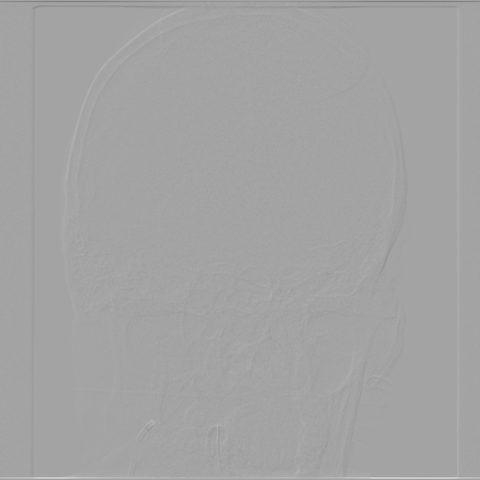 |
| **Segmentation in motion** — the segmented tumour turning with its feeding arteries. | **DSA cine** — a subtracted run playing at the scanner's frame rate. |

| | |
|---|---|
| 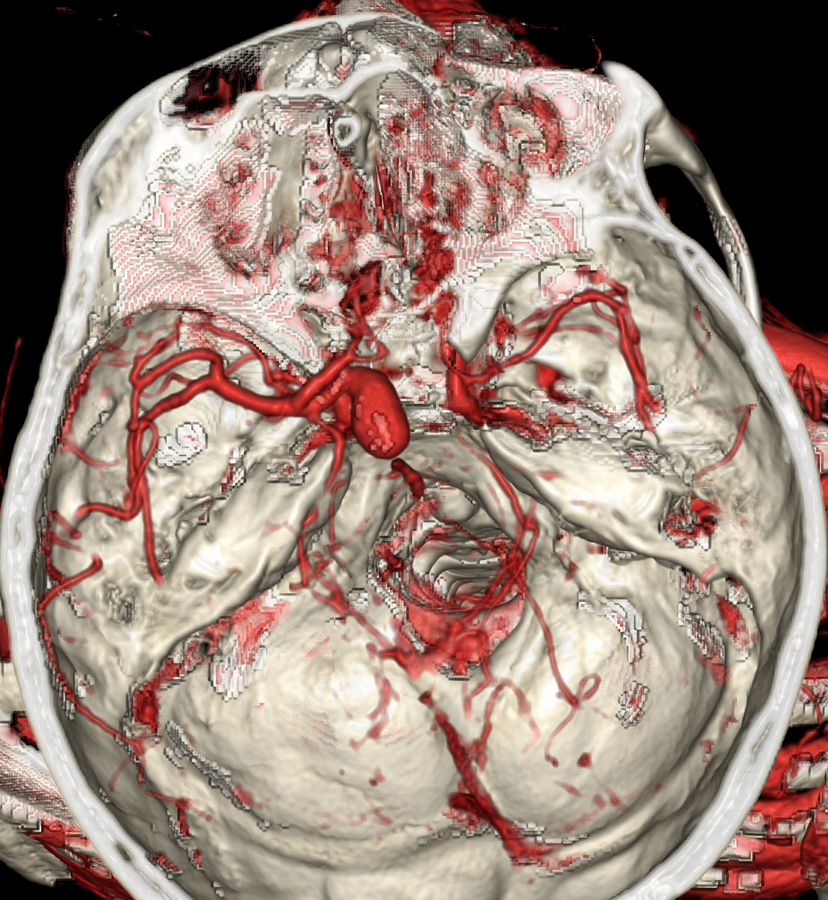 | 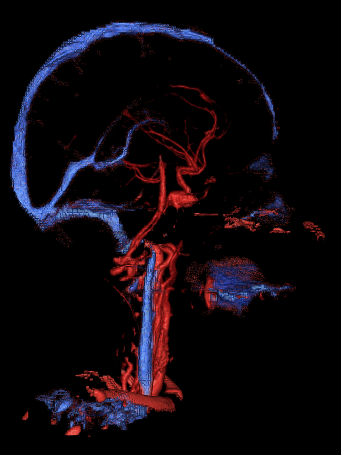 |
| **Bone lock from the plain scan** — a CTA from above, vault cut away: the aneurysm and its ICA on the clinoid stay whole and red, the skull base stays white. | **Arteries and veins on one series** — a routine contrast head CT of a child: the vessel atlas and two trees colour the sinuses and jugular blue, the carotids and the circle of Willis red. |
| 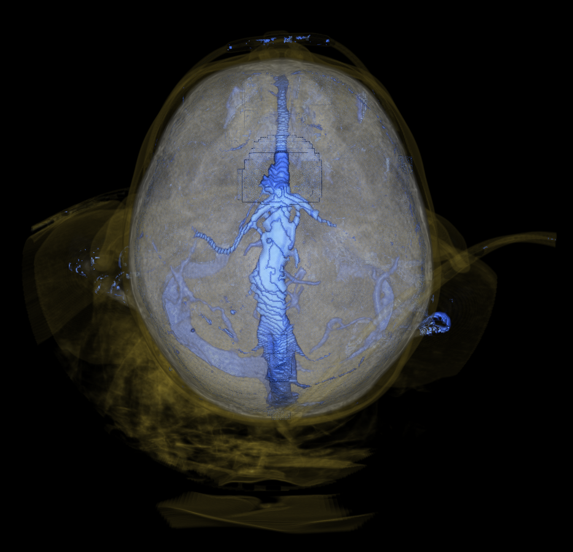 | 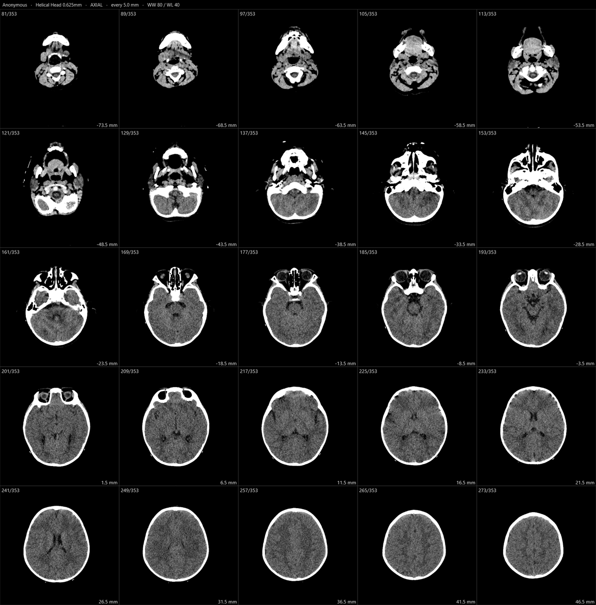 |
| **CT venography** — the same study from above: superior sagittal sinus, cortical and deep veins, no arteries. | **Collage** — a head CT as one 5 × 5 image, one slice every 5 mm, in the anonymous display mode. |

## What's new in 1.0.5

- **Bone lock from the plain scan**: on a study with a pre-contrast scan, bone is what was bone before contrast, voxel
  by voxel; a scan the patient moved in is lined up slab by slab (40 mm, up to 4 mm). An aneurysm and its ICA lying on
  the clinoid keep their edge, and a child's thin facial bones, spine and ribs stay white. The 3D panel says which
  source was used (plain scan, CTA rule, newborn skull or threshold).
- **Newborn skull**: skull plates under 500 HU are found by their shape and coloured as bone from 150 HU; fontanelles
  and sutures stay open instead of the whole skull turning red.
- **Arteries and veins on one contrast series**: the vessel atlas plants seeds (sinuses, thick veins, ICA / M1 /
  basilar) and two trees grow through the vessels, so a sinus stays blue along its length and the jugular follows the
  sigmoid sinus (84 → 88 % of vessel voxels right on 6 real CTAs).
- **CT venography shows veins only**: arteries found by both phases or by the atlas are hidden.
- **Web**: the bone area is made in a background worker before the first 3D frame, so 3D opens with the bone lock on in
  one step; on an iPhone the plain scan is read for the bone area and released after, and a CTA's other phase is not
  read (it ran out of memory).

## Download and install

Download the latest version from the [**Releases**](../../releases) page:

| File | What it is |
|---|---|
| `SoEasy-DICOM-Viewer-x.y.z-Setup.exe` | Installer (recommended): Start-menu and desktop shortcuts, *Open in SoEasy DICOM Viewer* on folders in Explorer, optional *Open with* for .dcm files, clean uninstall. |
| `SoEasy-DICOM-Viewer-x.y.z-portable.zip` | No installation: unzip anywhere (e.g. a USB stick) and run `SoEasy DICOM Viewer.exe`. |
| `SHA256SUMS.txt` | Checksums to verify the downloads. |

The installer is not code-signed yet, so Windows SmartScreen may show *Windows protected your PC*: choose
*More info → Run anyway*. Colour presets and settings are kept in `%APPDATA%\DicomColorViewer` and survive updates
and uninstalling.

## Web version

**[SoEasy DICOM Web](https://trithonese.github.io/SoEasy-DICOM-Web/)** is the browser version of this viewer for
iPad, iPhone, Android, Mac and Linux — and for any Windows PC where you cannot install software. Open the link; on
iPad / iPhone choose *Share → Add to Home Screen* to use it full-screen and offline. All processing stays on the
device; images are never uploaded. Its source is in [`web/`](web) of this repository; the built site is published to
[TrithoneSE/SoEasy-DICOM-Web](https://github.com/TrithoneSE/SoEasy-DICOM-Web).

Colour presets are the same .json files in both: export a preset here and import it in the web version, or the
other way round.

On phones and tablets the web version spares the device: a thin-pixel series (< 0.6 mm) is segmented on a grid halved
in-plane (a quarter of the work; the volume may differ by a few ml from the desktop's), and on an iPhone 3D opens a
large series (over ~80 MB of texture, e.g. a 0.625 mm head CT) at half resolution — *Full* in the 3D panel switches back.
The bone area of 3D and the sinus tracing of arteries / veins work on bit masks, 32 cells at a time (the same cells as
before; arteries / veins on a 0.625 mm CTA ~19 → ~13 s on a laptop). The bone area is made in a
background worker before the first 3D frame, so 3D opens with the bone lock on in one step while the wait panel keeps
turning; turning the lock on later, or moving its threshold, makes it there while the 3D view can still be turned.
Timings on a phone mean something only over https and from a production build: the same build served over plain http
from a laptop was 20–80× slower on an iPhone.

| | Desktop (this app) | [Web](https://trithonese.github.io/SoEasy-DICOM-Web/) |
|---|:---:|:---:|
| Runs on | Windows 10 / 11 | any modern browser, iPad, iPhone |
| 2D, presets, MIP / MinIP slabs, cine | ✅ | ✅ |
| DSA with automatic pixel shift | ✅ | ✅ |
| Layouts with reference lines | up to 5 × 5 | up to 2 × 2 |
| MPR, colour 3D, bone lock, rim filter, crop, scalpel, snapshots | ✅ | ✅ |
| Bone from the plain scan, newborn skull | ✅ | ✅ |
| Arteries / veins (both phases or vessel atlas), CT venography | ✅ | ✅ (on a phone from one series: a phone does not read a CTA's other phase) |
| Measurements | all 2D and 3D tools | 2D and MPR length, open polygon, angle, Cobb, ellipse ROI, movable captions; 3D length |
| Collage | ✅ | ✅ |
| Seed segmentation with range editor | ✅ | ✅ |
| STL, brush, 3D movies | ✅ | — |
| DTI, fusion, anonymous display | ✅ | — |
| Archives | .zip, .rar, .7z, .tar | .zip |

The web version's details are in [`web/README.md`](web/README.md).

## System requirements

| | Minimum | Recommended |
|---|---|---|
| Windows | 10 or 11, 64-bit | 11, 64-bit |
| Memory | 4 GB | 8 GB or more for large CT studies in 3D |
| Graphics | none (software rendering) | any GPU with OpenGL 3.2+ (Intel HD, AMD, NVIDIA) |
| Disk | 300 MB | |

On a PC without a working graphics driver — a virtual machine, a remote session, a very old office PC — the
viewer switches to software OpenGL by itself: every feature works, 3D is rendered by the processor and is
slower (the 3D view then uses half resolution for large volumes). The Start-menu shortcut
*SoEasy DICOM Viewer (safe graphics)* forces this mode if a graphics driver misbehaves.

## Getting started

1. **Open a study**: *Open* (Ctrl+O) and pick a folder, or drag a folder, files or an archive onto the window. In
   Explorer you can also right-click a folder → *Open in SoEasy DICOM Viewer*.
2. **Browse**: the series list on the left groups thumbnails by patient and study. Click a thumbnail, or drag it onto
   any viewport. Scroll with the mouse wheel; drag with the left button to change the window / level.
3. **Measure**: choose a tool (*Length* L, *Ellipse* E, …) — the left mouse button now draws it. Right-click a tool
   button to put it on the right mouse button instead.
4. **MPR / 3D**: *MPR* (Ctrl+M) and *3D* (Ctrl+3) open their own windows for the series in the active viewport.
5. Press **F1** in any window for its quick guide.

## Features in detail

### Loading
- Recursive folder scan, DICOMDIR, and archives (zip via Python, rar / 7z / tar via Windows' built-in `tar.exe`,
  with 7-Zip or WinRAR as fallback), nested up to three levels.
- Series are assembled in patient space from DICOM position and orientation, so axial, sagittal and oblique series
  line up; console reformats that include a reference image of another plane keep all their parallel slices.
- Multi-frame files (X-ray angiography runs, ultrasound loops) are one entry each — both planes of a biplane run —
  and play on opening. Compressed frames are decoded in the background, the frame on screen first.
- Files are read several at a time: the first opening of a folder (cold disk cache, antivirus scanning) is several
  times faster than reading them one by one.
- A second study opens in a new window (always for another patient) or, on request, in the same window for fusion.

### 2D viewing
- Window / level by dragging, with presets (keys 1–9), exact values, *Auto* (0) and *W/L ROI* (draw a box).
- Layouts from 1 × 1 to 5 × 5, slice synchronisation between series, cross-reference cursor (Q), rotate / flip /
  invert, MIP / MinIP / average slabs, smoothing and sharpening filters, colour maps.
- Reference lines (Ctrl+Shift+L): every viewport shows the current slices of the other viewports as coloured lines
  (yellow axial, pink coronal, blue sagittal) labelled with the series name. A line is only as long as that slice has
  image, so a partial MRI slab shows where it starts and ends. Scrolling any viewport moves its line in the others;
  dragging a line moves that viewport's slice. Lines are drawn only between series in the same patient coordinate
  system (frame of reference).
- Measurements: length, angle, Cobb angle, open / closed polygon, ellipse and rectangle ROIs (area, mean, SD,
  min / max), arrow, pencil, text and deviation. Lengths are shown in mm below 1 cm and in cm above. Captions can be
  dragged out of the way. ABC/2 volume calculator.
- **Collage** (toolbar *Collage*, *File → Collage…*, Ctrl+G): the active viewport's series, in the axial, coronal or
  sagittal plane (a thin-slice series gives sharp reformats, like MPR), as one image of 5 × 5,
  4 × 4, 4 × 3, 3 × 3 or any number of columns × rows, one slice every 5 mm by default (any interval can be set).
  The run of slices starts **centred** in the series — e.g. images 50–242 of a 292-slice 0.625 mm CT at 5 × 5 — so
  it covers the middle of the head rather than stopping short of the vertex; the *Position* slider (or *from*) moves
  it and *Centre* puts it back. When the slices are already that far apart and fit — a CT of 29 thick slices, an MRI
  of 20 — every slice is used. Tiles look exactly like the viewport (window / level, colour map, filter, slab,
  rotation, segments), with a header (series, plane, interval, window) and each image's number and position. Save
  writes a PNG / JPEG; Copy puts it on the clipboard.

### MPR
- Three orthogonal planes with draggable axes; drag a circle handle to tilt a plane (oblique MPR), drag the centre to
  move; *Roll* turns one view in its own plane. All 2D tools work in every view.

### 3D volume rendering
- GPU ray casting with lighting; VR, MIP and MinIP; quality settings and half-resolution mode for low memory.
- **Curve editor**: each tissue is a curve (opacity over HU) with its own colours, drawn over the histogram. Built-in
  presets (bone, CT angiography with arteries / veins, skin, muscle, enhancing lesion, lung), your own presets, and a
  colour picker that creates a curve from a tissue you click in 2D.
- **Bone colour lock**: the bone area is coloured only by bone curves, so vessels or a tumour with the same HU as the
  edge of bone keep their own colour. Bone is told from vessels by density, not by one threshold: an artery or an
  aneurysm above 500 HU on a CTA stays a vessel, even touching bone. The masks are found on a ~1 mm grid, but the edge
  of the bone area is drawn voxel by voxel from the HU (with both phases: bone is what the contrast does not change), so
  a sinus or an artery against the skull base keeps a smooth surface instead of blocks.
  When the study also has its plain (pre-contrast) scan, the bone comes from that scan instead: what was bone before
  contrast is bone, voxel by voxel, and only what got brighter with contrast takes a vessel colour. This keeps a child's
  thin facial bones and spine, a rib or the sternum white, where HU alone painted them red, and the bone curves start
  at 200 HU so thin bone shows. On a real infant contrast CT, 60 % of what had the vessel colour was bone on the plain
  scan; from it, none. A plain scan that does not line up as a whole (a CTA from the chest to the vertex: the head lies
  still while the jaw and neck bend between the scans) is lined up slab by slab, 40 mm each, moved by up to 4 mm; the
  slabs that still do not line up keep the rule below. The plain scan comes first also on a CTA opened with its other
  phase: a patient who moved between the phases had bone edges that "changed" and came out red. With both phases,
  bone outside the area that the phases do not call an artery stays bone too. A lumen is what got brighter where the
  plain scan held blood (under 130 HU): a plain scan of thicker slices blurs thin bone to 150–280 HU, which read as
  contrast before. A lumen lying on bone (an aneurysm and its ICA on the clinoid) keeps its edge: where the plain scan
  at the voxel itself is blood and the series 150 HU brighter, joined to a lumen within 1 mm, it is a vessel. On a
  phone the plain scan is read for the bone area and let go after (its copy on the bone grid stays). A phone does not
  read a CTA's other phase: the two series and their classification closed the page (an iPhone, 2 × 298 MB), so there
  the face of a CTA whose patient moved between the scans can still come out redder than on Windows, where with both
  phases bone outside the area that the phases do not call an artery stays bone (as on the web of a computer). What breathing moved more than that (ribs, clavicles of a CTA down to the chest) can still come
  out red. Without a plain scan, the rule for bright vessels is used only on a CTA; on a routine contrast
  CT everything above the threshold is bone. On a newborn's skull (most of its bone under 500 HU) the skull plates are
  found by their shape and are bone too, without the rule for bright vessels, and the bone curves start at 150 HU: the
  plates show white and the fontanelles and sutures stay open. The panel says which one was used. (Windows lines up a plain scan the
  patient moved in first; the web uses it only when it lines up as it is, to stay quick on a phone.)
- **Venography** (preset *CT Venography (contrast CT)*): a contrast head CT's dural sinuses and cortical and deep veins
  in blue over a faint brain, inside a faint skull and skin, and the neck's veins. The inside of the skull has curves of
  its own (Brain, Veins), so brain and scalp, which have the same HU, are coloured apart; gaps in the skull (an infant's
  fontanelles) are closed first. Vessels are told from the skull by their shape as well as their HU: a newborn's skull
  plates have the HU of veins (150-450 HU) but are thin sheets, found by the Hessian and never coloured as vessels, and
  they bound the cavity (before, the open sutures came out as veins). The study's plain scan, when it lines up (also of
  another field of view or tilt, and after the patient's motion between the scans is found and undone), adds that a
  vessel is bright only after contrast. Decisions are made on a voxel with its neighbours, so the noise of a thin
  low-dose scan does not turn the brain blue.
- **Arteries and veins** (preset *CT Angio - Arteries / Veins*): when the study has both an arterial and a venous series
  on the same grid, opening either one shows arteries with the HU of the arterial series and veins with those of the
  venous series. They are told apart by the time course and, where the "arterial" series was late and the sinuses
  already full, by anatomy (long thick vessels against the skull are sinuses); both grow through the vessels and meet
  where the trees touch. A pre-contrast series removes what was bright before contrast. A plain series is never taken
  for a phase: both must show contrast inside the skull. When both series came after the arterial peak (sinuses and
  neck arteries equally bright and washing out alike: 2 of 7 real CTAs), the time course says nothing and anatomy
  decides: in the head the vessel atlas (below); in the neck the jugulars are the lateral vessels and the carotids the
  medial ones, and the descending aorta is an artery. Bone that moved
  between the phases (jaw, shoulders) stays bone instead of turning into vein blocks or holes. 3D opened from the
  venous series starts on this preset; from the arterial series, or from a routine contrast CT, it starts on
  *Vessels + Bone*, and arteries / veins are one choice away (on one series with a note that the venous series of a
  CTA separates them more accurately). Separating them takes a few seconds; a "please wait" panel shows meanwhile.
- **Vessel atlas: arteries and veins on one contrast series** (a routine head CT + contrast, a tumour study, one phase
  of a CTA opened alone, and a CTA whose arterial series was late): an atlas of where arteries and veins run in the head
  (`assets/vessel_atlas.bin`, built from multiphase CTAs by `tools/build_vessel_atlas.py`) is laid onto the scan by its
  skull — position, rotation (a routine head CT is often tilted ~35° from a CTA), size — and labels the head's vessels;
  this patient's own HU, learnt from the places the atlas is sure of, and the course of each vessel refine it.
  Leave-one-out on 5 CTAs (atlas from 4, one series of the 5th, scored against its two-phase result): 84–94 % of the
  vessel voxels right (the anatomy tracing alone: 45–78 %). Large vessels (circle of Willis, carotid siphons, sinuses,
  deep veins) are reliable; small cortical vessels against the skull may be wrong, as their course varies between
  people. On a series that is not arterial (arteries and veins equally bright), the atlas then only plants seeds: veins
  in the traced sinuses and the thick vessels it is sure are veins, arteries in the thick ones it is sure are arteries
  (ICA, M1, basilar). Two trees grow from them through the vessels, and every vessel takes the label of the tree it is
  joined to, so a sinus stays blue all along and the internal jugular vein follows the sigmoid sinus. Scored the same
  way on 6 real CTAs (the venous series alone against its own two phases): 84 % of the head's vessel cells right with
  the atlas alone, 88 % with the trees, better on each study. Where a thin contact joins an artery and a vein, the tree
  that gets there first may take a stretch of the other. The *CT Venography* preset hides the arteries found this way (or
  by both phases of a CTA), so the MCA and ACA no longer show as veins; without an atlas that fits, it shows every vessel
  as before. The vessel curves of the preset move onto the scan's own vessel HU (~100–140 HU on a routine contrast CT).
  Outside the head, without a skull that fits the atlas, the sinuses are traced by anatomy (thick vessels against the
  inner table, tentorium and falx) and shown in blue, every other vessel red.
- **Rim filter**: curves marked *hide partial-volume rims* colour only homogeneous tissue, using a value × gradient
  transfer function, so an enhancing tumour is not confused with the walls of contrast-filled vessels. The *Rim
  threshold* slider sets how strict it is.
- Crop box, scalpel (cut inside / outside a drawn area, undo), inspect (click = HU and colour), orientation cube,
  standard views, free rotate / roll / turn / pan.
- 3D measurements: length, angle, Cobb, open polygon, arrow and text placed on the rendered surface.
- **Snapshots and movies**: save views (camera, crop, colours), jump between them, and render a smooth fly-through as
  an animated GIF or PNG sequence.

### Segmentation
- Ctrl+click a lesion in 2D (or use *Seed*): the region grows from the click, and its range curve opens right there, over
  the 2D and MPR windows. Drag its handles and the segment follows on the slices; no 3D is prepared until *Show in 3D*.
  The 3D window has the same curve, and a change in either moves the other. Re-growing looks first in a small window
  around the click and widens it only when the segment reaches its side, so a tumour follows the handles at once
  (real 0.43 mm CT: ~0.03 s for a 14 ml lesion, was ~0.4 s); a region that runs through much of the head takes seconds,
  and the curve says *growing…* meanwhile. The web grows the same way, widening only the sides the segment reaches
  (a seed on a 0.625 mm CT: a small lesion in ~0.15 s, a large frontal tumour in a few seconds, where it used to take
  minutes on a phone), with a *Segmenting…* bar.
- **On CT the automatic range keeps out of the neighbouring tissue**: a heterogeneous enhancing tumour has a wide spread
  of HU, so mean ± 2.5 SD reached down into the brain and the segment ran through it (real 0.625 mm CT: a frontal tumour
  came out at 100–700 ml). The range now stops at the valley between the tissue clicked and the largest tissue next to
  it in the histogram around the click (~56 HU there instead of ~38: the tumour alone, ~60–110 ml).
- **Anti-leak** (1.6 mm by default): contacts narrower than about 3 mm are cut, on lightly smoothed values so CT noise
  does not break the lesion apart, so a tumour does not run into a neighbour of the same HU (muscle, mucosa) through a
  thin contact. Set it to 0 for thin vessels.
- With the 3D window open, the range can also come from a tolerance, a manual range or a colour curve, limited to the
  crop box if wanted.
- *Smooth noise first* (off by default) grows on a lightly smoothed copy so CT noise does not break a lesion apart;
  leave it off for thin structures such as small vessels. Toggling it re-grows the selected segment from its click
  straight away, so you can compare both results (not after brush edits, which re-growing would discard).
- Result: a smooth 3D surface with its volume in ml; brush (B) to add or erase in 2D; STL export.

### DSA (digital subtraction angiography)
- `/` turns subtraction on: each frame minus the mask, on a light grey background. The mask is taken from the
  scanner's Mask Subtraction Sequence when present, otherwise frame 2; logarithmic subtraction for linear data.
- `Shift+/` makes the displayed frame the mask, `Ctrl+Shift+/` resets it.
- **Pixel shift** to correct patient motion: drag the mask (Shift+M), move it with Shift+arrows (1 px) or
  Ctrl+Shift+arrows (0.1 px), or let *Auto shift* (Ctrl+M in DSA mode) align it inside the yellow square you click.
- **Cine bar** over the image: previous / next series, previous / next frame, play / pause (Space) and the frame
  rate; runs play at the frame rate stored in the file.

### DTI and fusion
- Diffusion series with standard, Siemens (including mosaic), GE or Philips diffusion tags; tensor fit; FA, MD,
  colour-FA and b0 maps added to the series list.
- Deterministic tractography (whole brain or seed spheres), include / exclude spheres, colour by direction or FA,
  tubes, export, and sending the tracts into a 3D volume rendering.
- Fusion overlays any series on the active viewport with a colour map and opacity, matched in patient coordinates.

## Mouse and keyboard

| Main window | |
|---|---|
| Left / right mouse button | the tool assigned to it (click / right-click a tool button) |
| Middle button, wheel, Ctrl+wheel | pan, next slice, zoom at the cursor |
| W, M, Z, S | window / level, pan, zoom, browse |
| L, E, U, G, O, A, C, D, Y, P, T | length, ellipse, rectangle, polygon, open polygon, angle, Cobb, deviation, arrow, pencil, text |
| Q, K, B, J, R | 3D cursor, colour picker, brush, segmentation seed, W/L ROI |
| 1–9, 0, I | window presets, auto window, invert |
| Ctrl+O, Ctrl+Shift+O, Ctrl+N | open folder, open files / archive, new window |
| Ctrl+M, Ctrl+3, Ctrl+U, Ctrl+D | MPR, 3D, fusion, DTI |
| Ctrl+Space or Space | cine play / pause |
| / , Shift+/ , Ctrl+Shift+/ , Shift+M | DSA on / off, displayed frame as mask, reset mask, manual pixel shift |
| Ctrl+L, Ctrl+Shift+L, X, F, F11 | synchronise slices, reference lines, crosshair, maximise viewport, full screen |
| Ctrl+Shift+H | hide patient identity on screen |
| Ctrl+S, Ctrl+Shift+C, Ctrl+G, Ctrl+T | save image, copy image, collage, DICOM tags |
| F1 | quick guide (every window has its own) |

## Privacy

- Everything runs on your computer. The viewer makes no network connections and sends no data or statistics
  anywhere.
- Archives are unpacked into a temporary folder that is deleted when the viewer closes.
- *View → Hide patient identity* (Ctrl+Shift+H) replaces names, birth dates and study dates with "Anonymous" in the
  image overlay, window titles, series list and tooltips. The DICOM files themselves are never modified.
  Information burned into the pixels (e.g. dose reports or screen captures) cannot be hidden this way.

## Building from source

Requirements: Windows 10 / 11 64-bit, [Python 3.12](https://www.python.org/downloads/) 64-bit, and for the installer
[NSIS 3](https://nsis.sourceforge.io) (`winget install NSIS.NSIS`).

```powershell
git clone https://github.com/TrithoneSE/SoEasy-DICOM-Viewer.git
cd SoEasy-DICOM-Viewer
py -3.12 -m venv .venv
.venv\Scripts\python -m pip install -r requirements-lock.txt
.venv\Scripts\python main.py                      # run from source
.venv\Scripts\python tests\run_all.py             # GUI tests on the synthetic samples
.venv\Scripts\python packaging\build.py --installer
```

`packaging/build.py` builds `dist\SoEasy DICOM Viewer\` with PyInstaller, then runs the built program's own
`--selftest` on the graphics driver and on software OpenGL (2D, MPR, 3D rendering, DSA, DTI, archive extraction,
every image codec) and refuses a build that fails. With `--installer` it also writes the NSIS installer, a portable
zip and their SHA-256 checksums. Pushing a tag such as `v1.0.0` builds the same files on GitHub Actions and attaches
them to a draft release.

Keep the project in a short path (e.g. `C:\src\SoEasy-DICOM-Viewer`): Qt's deep folder names can exceed the Windows
path limit otherwise.

## Project layout

```
main.py                 entry point: graphics selection, logging, --selftest
dcv/
  loader.py             folder / archive scan, series assembly, background frame decoding
  archive.py            .zip / .rar / .7z / .tar extraction
  main_window.py        main window, series list, layouts, menus
  slice_view.py         2D viewport: tools, measurements, DSA, cine
  measure.py            2D measurements
  collage.py            collage of a series as one 5 × 5 / 4 × 4 / 4 × 3 image
  mpr_window.py         MPR window
  vr_window.py          3D window: curve editor, segmentation, snapshots
  volume_view.py        3D rendering, crop, scalpel, 3D measurements
  tf_model.py           colour curves and presets
  tf_editor.py          curve editor widget
  segment.py            per-series state, bone lock, region growing
  phases.py             arterial and venous series of a CTA: arteries, veins, bone
  atlas.py              vessel atlas: skull registration, arteries / veins by where they run
  seed_range.py         range curve of a seed, in 2D and 3D
  dsa.py                digital subtraction
  dti.py                diffusion tensor and tractography
  tract_window.py       tractography window
  snapshots.py          3D snapshots and movies
  graphics.py           hardware / software OpenGL selection
  vtk_lite.py           the VTK classes in use (keeps the build small)
  privacy.py            anonymous display
  selftest.py           build self-test
samples/                synthetic studies (head CT, phantom, MRI with DTI) used by the tests
tests/                  GUI tests driving the real windows
packaging/              PyInstaller spec, NSIS installer, build script
```

## Contributing

Bug reports and pull requests are welcome. Please do **not** attach patient images or DICOM files to issues — describe
the scanner, the series type and what you saw, or share an anonymised study privately. Run `tests\run_all.py`
before sending a pull request; a new feature or fix comes with a test.

## Licence and third-party software

SoEasy DICOM Viewer is free software under the **GNU General Public License v3.0** (see [LICENSE](LICENSE)).
You may use, study, share and modify it; distributed modified versions must stay under the same licence.

The application is built on these open-source projects, each under its own licence:

| Project | Use | Licence |
|---|---|---|
| [Qt for Python (PySide6)](https://www.qt.io/qt-for-python) | user interface | LGPL-3.0 |
| [VTK](https://vtk.org) | 3D rendering | BSD-3-Clause |
| [pydicom](https://pydicom.github.io) | DICOM reading | MIT |
| [pylibjpeg](https://github.com/pydicom/pylibjpeg), pylibjpeg-libjpeg, pylibjpeg-openjpeg | JPEG / JPEG 2000 decoding | MIT, GPL-3.0, MIT |
| [NumPy](https://numpy.org) | image maths | BSD-3-Clause |
| [Pillow](https://python-pillow.org) | GIF / PNG output | MIT-CMU |
| [Mesa](https://mesa3d.org) (shipped with Qt as `opengl32sw.dll`) | software OpenGL | MIT |
